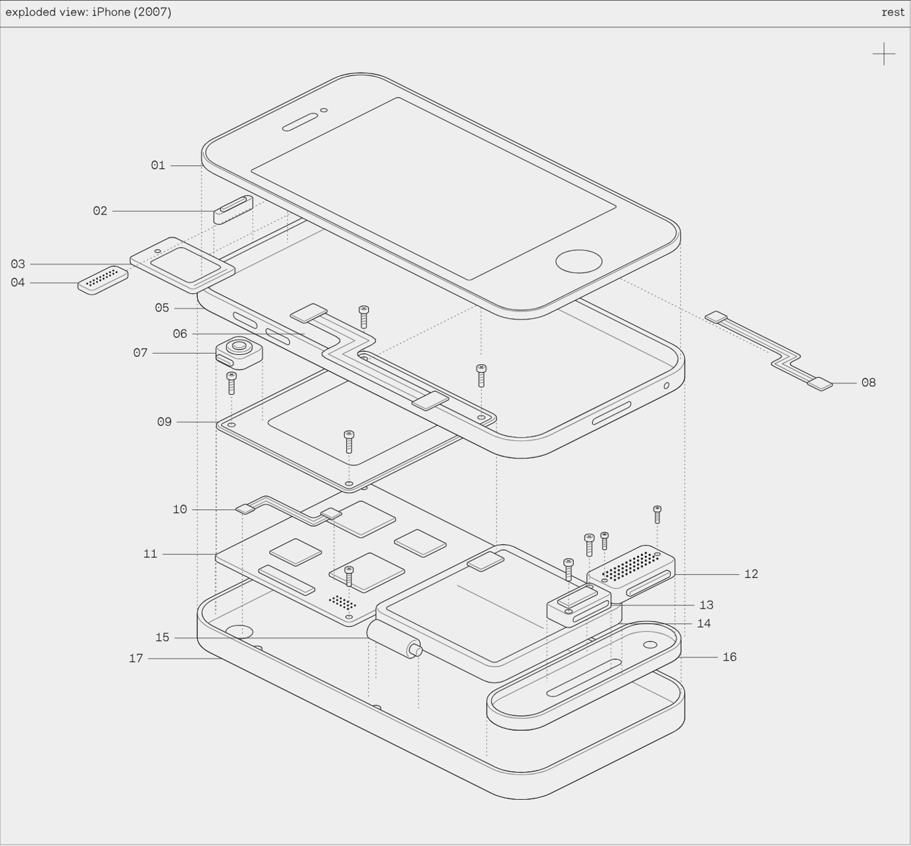
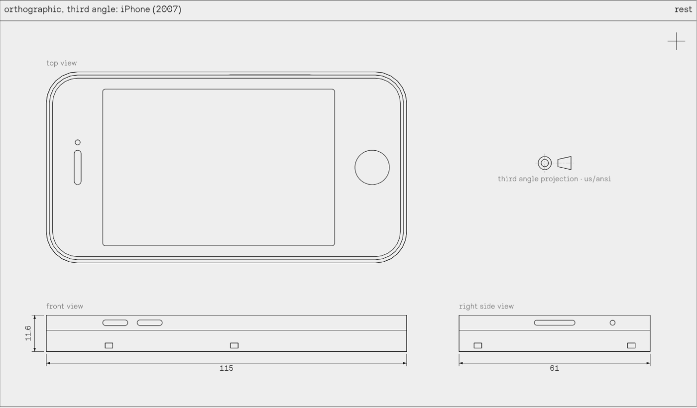

# Blueprint-ify

Name a product, add reference photos or paste spec notes, and Blueprint-ify draws it as a technical drawing you can take apart. Slide from assembled to exploded, switch to orthographic or section views, click any part for a detail window, and export clean line art.



## What it does

- Draws a product from its name, up to five reference photos, or text pasted from a teardown or spec sheet.
- Claude works out the parts (at least 20 for most products), their real sizes in mm, and how they stack. A second pass checks the drawing against the real product and corrects it.
- Explode slider and play button. Products come apart upward, or out of the front for things like fridges and ovens.
- Isometric, orthographic (third angle US/ANSI or first angle ISO) and section views with a draggable cutting plane.
- Click a part for a detail window with its overall dimensions.
- Export the drawing as SVG line art or PNG, the inventory as SVG, each detail window as SVG or PNG, and the spec as JSON. Labels can be turned off for exports.



## Three ways to draw

1. **Inside Claude.** Opened as a Claude artifact, the page draws on the viewer's own Claude account. The viewer has to be signed in to Claude and allow the page to use Claude.
2. **With your own API key.** Open the site anywhere else, paste an Anthropic API key into the "claude api key" box and press blueprint-ify. The key stays in your browser and goes only to `api.anthropic.com`. Drawings are billed to that key: Claude Sonnet 5.5 drafts, Claude Opus 5.5 checks.
3. **With any AI chat.** No key at all: press copy prompt, paste the prompt into Claude or another chat, then paste the reply back into the page.

## Run it

Clone the repo and open `index.html` in a browser. Nothing to install.

```sh
git clone https://github.com/YOUR-NAME/blueprint-ify.git
cd blueprint-ify
python3 -m http.server 8000   # optional, then visit http://localhost:8000
```

## Put it online with GitHub Pages

1. Push this folder to a GitHub repository.
2. In the repository, open Settings, then Pages. Under "Build and deployment", choose "Deploy from a branch", pick `main` and `/ (root)`, and save.
3. The site appears at `https://YOUR-NAME.github.io/blueprint-ify/`. Visitors draw with their own key, or with copy prompt.

## Let visitors draw on your account (optional)

If you want people to draw without a key of their own, run the small proxy in `proxy/`. It is a Cloudflare Worker that holds your API key and forwards the page's requests to Claude.

```sh
cd proxy
# set ALLOWED_ORIGINS in wrangler.toml to your site, e.g. https://YOUR-NAME.github.io
npx wrangler secret put ANTHROPIC_API_KEY
npx wrangler secret put ACCESS_CODE      # optional: a code visitors must type in
npx wrangler deploy
```

Then put the Worker's address in `config.js`:

```js
window.BLUEPRINTIFY = { api: "https://blueprintify-proxy.YOUR-NAME.workers.dev" };
```

Every drawing then runs on your API account, so set a spend limit for that key in the Claude Console. The proxy only accepts the three model IDs the page uses, caps the output length, and strips anything else from requests.

## Edit and rebuild

The page is one self-contained HTML file built from `src/`:

| File | What it holds |
| --- | --- |
| `src/page.html` | layout, styles and markup |
| `src/app.js` | spec handling, isometric drawing, layout, paint order, prompts, Claude calls, exports |
| `src/flat.js` | orthographic and section views, detail windows |
| `src/presets.js` | the iPhone and Game Boy examples |
| `vendor/hairline-kernel.js` | the Hairline drawing kernel |
| `fonts/CaliperSans-Regular.otf` | the typeface, embedded at build time |

```sh
python3 build.py
```

This writes `index.html` (the standalone site) and `dist/blueprint-ify-artifact.html` (the same page for publishing as a Claude artifact). The prompts Claude receives, including the full spec format, are `FORMAT`, `PROMPT` and `REFINE` in `src/app.js`.

## Credits

- Drawing kernel: [Hairline](https://github.com/lucasmarkes/hairline) by Lucas Marques, MIT License. See `vendor/HAIRLINE-LICENSE`.
- Typeface: Caliper Sans, in `fonts/`. The font is not covered by this repository's license.
- Code: MIT License. See `LICENSE`.
